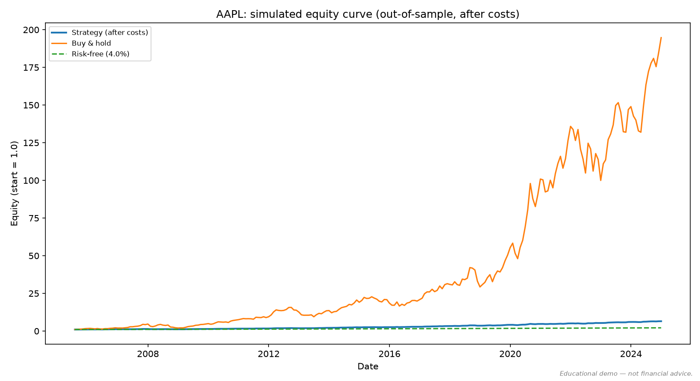

# Corrected monthly study results

> **Educational demo — not financial advice.** Recomputed October 28, 2026 (UTC)
> with corrected holdings and transaction-cost accounting.
> All eight requested tickers completed: **beat buy-and-hold 0/8; beat the configured
> 4% risk-free benchmark 7/8**. These are descriptive historical results, not a new
> independent holdout or evidence that an edge is impossible.

The prior numerical report is superseded and preserved in the labeled archive below,
including its unchanged pre-registration. Its simulator did not charge all trades
needed to restore fractional weights after market movements. Fresh input data and
corrected complete-month boundaries also differ from the historical run; differences
between the two reports cannot be attributed to accounting alone.

## Recorded method and evidence

The full-precision scorecards, final-period metrics, configuration, per-ticker source
hashes, data fingerprints, variant IDs, warnings, and dependency versions are in
[`results/monthly-study-corrected.json`](results/monthly-study-corrected.json).
All eight input snapshots passed the script's monthly completeness checks. There were
no failed or excluded tickers in this run.

| Item | Recorded value |
|---|---|
| Requested tickers | AAPL, MSFT, KO, JNJ, XOM, JPM, SPY, PG |
| Requested prices | `[2005-01-01, 2025-01-01)`; end exclusive |
| Observed daily range | 2005-01-03–2024-12-31 for all eight |
| Monthly observations | 240 per ticker |
| Equity evaluation range | 2005-07-31–2024-12-31; 233 monthly returns after warmup |
| Signal / sizing | Price-only Holt-Winters; volatility target 10% annualized |
| Costs | Commission 1 bps + half of 5 bps full spread + 5 bps slippage |
| Initial capital / fixed fee | 10,000 / 0 currency units |
| Cash benchmark | Constant 4% annual rate, not historical T-bill yields |
| Acquisition | Fresh yfinance download with `auto_adjust=True`; no SQLite cache or news |
| Recorded UTC acquisition/run interval | 2026-10-28 06:22:26–06:23:15 UTC |
| Environment | Python 3.12.12; NumPy 2.5.3; pandas 3.0.6; statsmodels 0.15.0; yfinance 1.7.0 |
| Earlier experiments | Unknown; this run does not establish a total variant count |

Package source identity:
`sha256:b6e15ddae37db637ed33822111e58079fa750c7a2b95ee2fa8b54bc26bad8cfa`.
The regeneration-script hash and original manifest hash are retained in the JSON.
The package was identified by source content, including local changes, rather than a
claim that an uncommitted run used an already released commit.

Raw price CSVs and the detailed equity arrays were retained locally under
`/tmp/stockpredictor-results-review-network/`; they are **not embedded in the repository
evidence JSON**. Its relative snapshot/artifact paths refer to that local run directory.
The evidence file records their identities, but public readers need those snapshots
for byte-identical replay. A new download is a new data vintage.

## Full-period readings — all eight tickers

“Beat” compares CAGR after costs. Excess CAGR is in percentage points (pp); turnover
is annual traded notional divided by equity, and maximum drawdown is for the strategy.

| Ticker | Strategy CAGR | BH CAGR | Excess CAGR vs BH | Excess Sharpe vs BH | Max drawdown | Turnover | Beat BH / RF? |
|---|---|---|---|---|---|---|---|
| AAPL | 10.14% | 31.19% | -21.05 pp | -0.077 | -15.11% | 1.25x | NO / YES |
| MSFT | 7.51% | 17.67% | -10.16 pp | -0.219 | -18.49% | 2.68x | NO / YES |
| KO | 6.45% | 8.80% | -2.35 pp | -0.050 | -16.00% | 4.32x | NO / YES |
| JNJ | 4.00%† | 7.34% | -3.34 pp | -0.245 | -14.30% | 3.94x | NO / NO |
| XOM | 5.16% | 6.69% | -1.53 pp | -0.039 | -14.47% | 3.41x | NO / YES |
| JPM | 7.11% | 13.33% | -6.22 pp | -0.036 | -14.41% | 2.62x | NO / YES |
| SPY | 5.88% | 10.41% | -4.53 pp | -0.196 | -13.81% | 4.03x | NO / YES |
| PG | 8.24% | 8.82% | -0.59 pp | +0.136 | -12.06% | 3.26x | NO / YES |

† JNJ's unrounded CAGR is **3.999945%**, slightly below 4%; the rounded table is not
a tie. Across these eight selected survivors, the strategy ended behind buy-and-hold
on CAGR in every case. That finding is limited to this configuration, sample, and
simplified cost assumptions. It does not validate the earlier band-to-move explanation:
that diagnostic was not regenerated here. PG's positive excess Sharpe does not change
its lower CAGR relative to buy-and-hold.



## Final-period readings — descriptive only

The final 12 returns span equity timestamps 2023-12-31–2024-12-31. They are already
included above and can be inspected on every rerun. No separate protected evaluation
was conducted; correcting code does not make previously viewed periods unseen.

| Ticker | Strategy return/CAGR | BH return/CAGR | Beat BH / RF? |
|---|---|---|---|
| AAPL | +8.18% | +30.71% | NO / YES |
| MSFT | +2.13% | +12.93% | NO / NO |
| KO | -0.25% | +8.88% | NO / NO |
| JNJ | -7.31% | -4.81% | NO / NO |
| XOM | +5.41% | +11.26% | NO / YES |
| JPM | +9.21% | +44.29% | NO / YES |
| SPY | +4.25% | +24.89% | NO / YES |
| PG | +6.41% | +17.25% | NO / YES |

These are one-year returns, so return and CAGR coincide. Twelve observations provide
limited support for risk-adjusted inference. The final-period values neither establish
an independent replication nor justify a once-only validation claim. Future claims
need a separately protected dataset or evaluation procedure, frozen settings, and a
record of all attempted variants. Selection of long-lived names, adjusted-price
revisions, constant risk-free rates, monthly sampling, and simplified fills remain
limitations.

## Regenerate the monthly study

From the checkout root, provide one `TICKER.csv` per requested ticker, with `Date`
(`YYYY-MM-DD`) and `Close` columns. **Close must already be split/dividend adjusted.**
Keep the provenance and adjustment date of those snapshots. The default universe is
AAPL, MSFT, KO, JNJ, XOM, JPM, SPY, PG; the default requested window is
`[2005-01-01, 2025-01-01)`, which includes the complete December 2024 month.

```bash
# Offline replay; no price cache or news requests are used.
python -m scripts.regenerate_results \
  --prices-dir /path/to/adjusted-price-snapshots \
  --source-label "provider and snapshot acquisition date" \
  --outdir stock_plots/regenerated-study-01

# Explicit alternative: fetch fresh adjusted prices and retain their CSV snapshots.
python -m scripts.regenerate_results --download \
  --outdir stock_plots/regenerated-study-fresh-01
```

Use a new output directory for every run. `summary.json` lists **every requested
ticker**, including errors, actual input date ranges, data and configuration identities,
source snapshots, code hashes, dependency versions, and final-period metrics. Per-ticker
`TICKER_SIM_metrics.json` files contain results or an explicit error. Undefined metrics
are JSON `null`. Any ticker failure gives a nonzero exit status; an interrupted run
keeps a visibly incomplete summary. Shorter source coverage is flagged, not concealed.

The script deliberately does not read the legacy SQLite cache or claim knowledge of
past experiments. Its retained `prices/` directory can be used as the next offline
input. Follow [`RESULTS_TEMPLATE.md`](RESULTS_TEMPLATE.md) when interpreting the new
artifacts, report every failure and every attempted configuration, and record the
actual post-warmup evaluation dates. Fresh downloads may revise historical adjusted
prices; exact replay requires the retained CSV snapshots. This script regenerates the
monthly trading study, not the separate Phase 5 predictability screen.

## Historical archive — numerical results invalidated

<details>
<summary>Original report and unchanged pre-registration (superseded)</summary>

# Results: Does the Simulated Betting Layer Beat Buy-and-Hold After Costs?

> ⚠️ **Educational demo — not financial advice.** This is a paper-trading study. No
> real orders were placed. A null result (no durable edge after costs) is the
> expected and honest outcome, not a defect.

> A worked example produced with [`RESULTS_TEMPLATE.md`](RESULTS_TEMPLATE.md). §2 was
> written before any curves were examined and has not been edited since.

**TL;DR:** Across 8 single-ticker out-of-sample studies (2005–2024, vol-targeting,
default costs), the strategy **beat buy-and-hold 0/8** and **beat the risk-free rate
7/8** after costs. This matches the pre-registered expectation, and no result tripped
the red-flag threshold. The value here is the instrument producing a *credible null* —
not a profit. The mechanism is explicit: the one-month prediction band is ~5× wider
than the move it predicts, so there is no extractable edge and sizing correctly stayed
modest.

---

## 1. What was tested

| Item | Value |
|---|---|
| Commit / release | `7fec68e` (Phase 4 merged) |
| Tickers studied | AAPL, MSFT, KO, JNJ, XOM, JPM, SPY, PG |
| Study type | single-ticker timing (sidesteps survivorship) |
| In-sample window (tuning) | none — no parameters were tuned on this data |
| **Out-of-sample window (reported)** | 2005-01-01 → 2024-12-31 (OOS by construction) |
| Held-out slice (touched once) | final 12 months |
| Rebalance cadence | monthly |
| Sizing method | volatility targeting (default) |
| Cost assumptions | commission 1 bps, spread 5 bps, slippage 5 bps |
| Risk-free rate used | 4.0% (default constant) |
| Variants tried (total) | **N = 1 per ticker** — a single pre-decided config, no tuning |

No parameter was fitted on this data, so there is no separate tuning split: the walk-
forward simulation is out-of-sample by construction (the weight at month *t* uses only
prices ≤ *t* and earns the realized *t→t+1* return). The final-12-month held-out slice
is the once-touched check.

Reproduce any single study with:

```bash
python3 stock_forecast_with_sentiment.py \
  --tickers AAPL --start 2005-01-01 --end 2024-12-31 \
  --simulate --sizing vol --rf-rate 0.04 \
  --commission-bps 1 --spread-bps 5 --slippage-bps 5 --holdout 12
```

---

## 2. Pre-registration (written BEFORE looking at §3)

- **Prior:** I expect the strategy to **not** beat buy-and-hold after costs on most
  large-cap single names, because those names had strong secular uptrends that
  buy-and-hold captures fully while a monthly timing strategy sits out part of the run
  and bleeds turnover/costs. I expect it **may** beat the risk-free rate (it is long
  much of the time in rising names).
- **What would change my mind:** a positive result is credible only if it survives the
  held-out slice with N small (it is: N=1, no tuning).
- **Red flag:** any ticker with **excess Sharpe > ~1.0 vs BH out-of-sample** — more
  likely a bug than an edge.

---

## 3. Readings (all 8 — no selective reporting)

```
SCORECARD — AAPL    Beat BH? NO (excess CAGR -21.1%, excess Sharpe -0.08) | Beat RF? YES (+6.1%)
  Strategy CAGR +10.1% | Sharpe +0.84 | Max DD -15.1% | Turnover 1.2x | Held-out: BH=NO, RF=YES
SCORECARD — MSFT    Beat BH? NO (excess CAGR -10.2%, excess Sharpe -0.22) | Beat RF? YES (+3.5%)
  Strategy CAGR  +7.5% | Sharpe +0.44 | Max DD -18.5% | Turnover 2.7x | Held-out: BH=NO, RF=NO
SCORECARD — KO      Beat BH? NO (excess CAGR  -2.3%, excess Sharpe -0.05) | Beat RF? YES (+2.4%)
  Strategy CAGR  +6.4% | Sharpe +0.32 | Max DD -16.0% | Turnover 4.3x | Held-out: BH=NO, RF=NO
SCORECARD — JNJ     Beat BH? NO (excess CAGR  -3.3%, excess Sharpe -0.25) | Beat RF? NO (-0.0%)
  Strategy CAGR  +4.0% | Sharpe +0.04 | Max DD -14.3% | Turnover 3.9x | Held-out: BH=NO, RF=NO
SCORECARD — XOM     Beat BH? NO (excess CAGR  -1.4%, excess Sharpe -0.04) | Beat RF? YES (+1.2%)
  Strategy CAGR  +5.2% | Sharpe +0.19 | Max DD -14.5% | Turnover 3.4x | Held-out: BH=NO, RF=YES
SCORECARD — JPM     Beat BH? NO (excess CAGR  -6.2%, excess Sharpe -0.04) | Beat RF? YES (+3.1%)
  Strategy CAGR  +7.1% | Sharpe +0.42 | Max DD -14.4% | Turnover 2.6x | Held-out: BH=NO, RF=YES
SCORECARD — SPY     Beat BH? NO (excess CAGR  -4.5%, excess Sharpe -0.20) | Beat RF? YES (+1.9%)
  Strategy CAGR  +5.9% | Sharpe +0.28 | Max DD -13.8% | Turnover 4.0x | Held-out: BH=NO, RF=YES
SCORECARD — PG      Beat BH? NO (excess CAGR  -0.6%, excess Sharpe +0.14) | Beat RF? YES (+4.2%)
  Strategy CAGR  +8.2% | Sharpe +0.50 | Max DD -11.8% | Turnover 3.3x | Held-out: BH=NO, RF=YES
```

### 3.2 Aggregate

| Ticker | Beat BH? | Beat RF? | Strat CAGR | BH CAGR | Excess Sharpe | Max DD | Turnover | 80%-band ÷ move |
|---|---|---|---|---|---|---|---|---|
| AAPL | NO | YES | +10.1% | +31.2% | −0.08 | −15.1% | 1.2x | 3.4x |
| MSFT | NO | YES | +7.5% | +17.7% | −0.22 | −18.5% | 2.7x | 5.7x |
| KO | NO | YES | +6.4% | +8.8% | −0.05 | −16.0% | 4.3x | 3.4x |
| JNJ | NO | NO | +4.0% | +7.3% | −0.25 | −14.3% | 3.9x | 4.7x |
| XOM | NO | YES | +5.2% | +6.6% | −0.04 | −14.5% | 3.4x | 8.0x |
| JPM | NO | YES | +7.1% | +13.3% | −0.04 | −14.4% | 2.6x | 5.9x |
| SPY | NO | YES | +5.9% | +10.4% | −0.20 | −13.8% | 4.0x | 4.8x |
| PG | NO | YES | +8.2% | +8.8% | +0.14 | −11.8% | 3.3x | 3.4x |

**Beat buy-and-hold: 0/8 · Beat risk-free: 7/8 · held-out agrees BH=NO on 8/8 · median band÷move 4.7x.**

_(Equity-curve overlays are reproducible per ticker via the §1 command, which writes
`TICKER_SIM_equity.png` / `.html`.)_

---

## 4. Interpretation

1. **Beat both benchmarks after costs, out of sample? No — 0/8 on buy-and-hold.** The
   once-touched held-out slice independently agrees on all 8 names.
2. **This is the expected outcome, and it is the result.** The mechanism: these are
   strong secular up-trenders (AAPL buy-and-hold +31% CAGR). A monthly timing strategy
   parks in cash part of the time, so it captures *less* of the trend (lower CAGR) — and
   although it cut drawdowns to −12…−18% (vs buy-and-hold's far deeper 2008/2022 dips),
   **excess Sharpe stayed negative on 7/8**: being out of a relentless bull cost more
   than the volatility it saved. Turnover (1.2–4.3×/yr) bled the remainder.
3. **No surprising positives to scrutinize.** The single positive excess Sharpe (PG,
   +0.14) is far below the red-flag line, so §5's deep checklist is not triggered.
4. **The prediction intervals are the whole story.** The 80% band was a **median 4.7×
   wider than the one-step expected move** (range 3.4–8.0×). The model cannot reliably
   tell a +1% month from a −1% month — so there is no edge to extract, and vol-targeting
   correctly sized modestly. This is *why* a well-calibrated forecast still is not a
   tradeable edge: calibration and edge are different things.

---

## 5. Suspicion checklist

Not triggered — no "beat both benchmarks" result exists, and the lone positive excess
Sharpe is +0.14. For completeness, the harness is calibrated in both directions
independently of this run: the zero-edge synthetic test shows no edge on a random walk
(won't flatter noise) and the known-edge test captures injected AR(1) predictability
(won't destroy real signal); the leakage tripwire confirms the production path does not
peek. The real-data null is therefore "no edge was present," not "the instrument is
blind."

---

## 6. Limitations

- **Survivorship** — single-ticker studies mitigate this, but all 8 names were chosen
  for long history and are themselves survivors, a mild upward bias on buy-and-hold. The
  real fix (point-in-time / delisting-aware universe) is gated Phase 5.
- **Monthly cadence** — short-horizon dynamics are out of scope.
- **Cost model** — a simplified bps model; real fills, market impact, and borrow differ.
- **Single regime / fixed list** — one broad 2005–2024 sweep; eight large-caps; results
  may not generalize across regimes or to small-caps.
- **Price-only signal** — sentiment was deliberately excluded from the simulated signal
  to avoid lookahead (sentiment is only available "now").
- **Not financial advice** — paper-trading study only.

---

## 7. Conclusion

Run honestly on eight real names over twenty years, the strategy did **not** beat
buy-and-hold after costs (0/8), and beat the risk-free rate on 7/8 — exactly the
pre-registered expectation, with the held-out slice in agreement and no result
crossing the red-flag line. A null after costs is the correct and expected outcome for
retail monthly single-name timing; the project's contribution is the instrument that
produces it credibly — cost-aware, leakage-checked, benchmarked against both
buy-and-hold and cash, and calibrated to detect a real edge when one exists. The
clearest finding is conceptual: the one-step prediction band dwarfs the expected move
(~5×), which is precisely why a well-calibrated forecast is not, by itself, a tradeable
edge. Extending beyond this null (short-horizon signals, a point-in-time universe) is
gated Phase 5 and not undertaken here.

</details>
